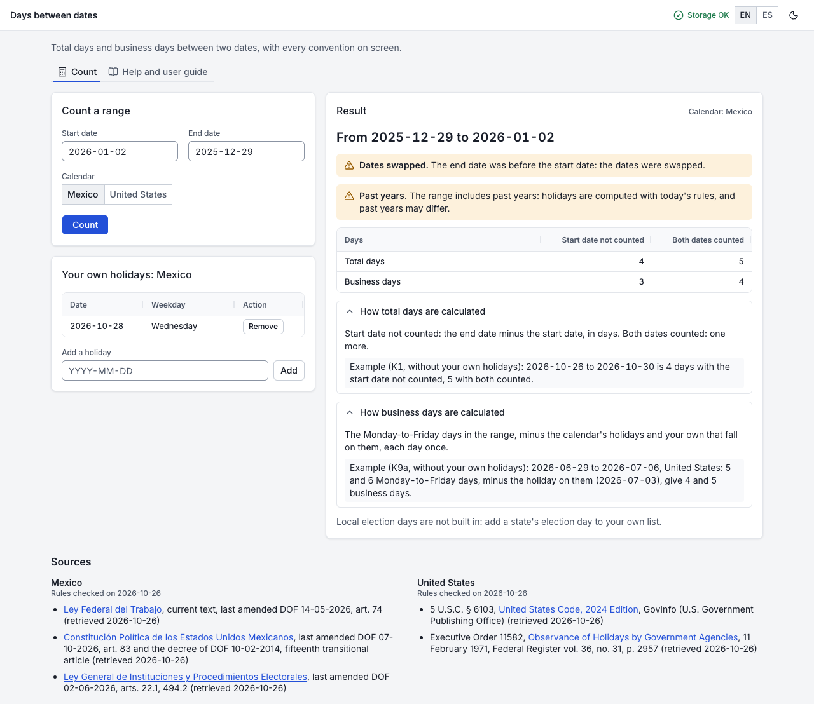
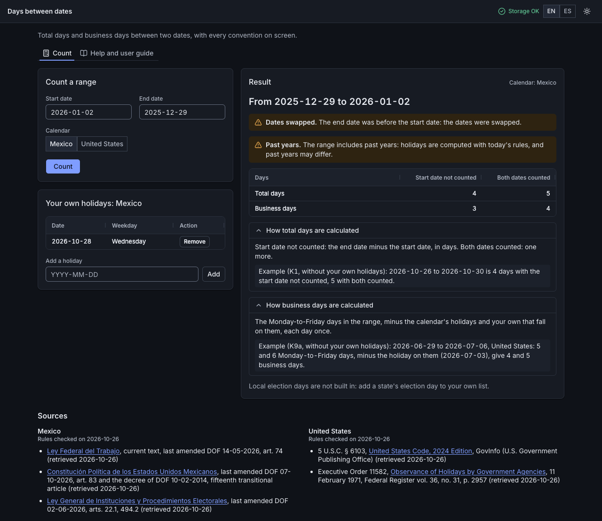
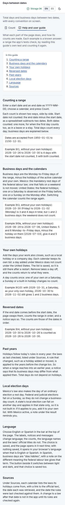

# Days between dates

A small web app that counts the days between two dates: total days and business days, shown side by side under the
two usual conventions (the start date not counted · both dates counted).

- **Business days** are Monday to Friday minus the active calendar's holidays: Mexico's mandatory rest days under the
  federal labour law (Ley Federal del Trabajo, art. 74), or the United States' federal legal public holidays
  (5 U.S.C. § 6103) with their observed days.
- **Your own holidays**: add or remove days, one list per calendar. They are stored in SQLite and survive a restart.
- **Every convention on screen**: the active calendar is named, reversed dates are swapped with a notice, a range that
  reaches into past years says the holidays use today's rules, and each calendar lists its sources and the date its
  rules were checked.
- **English and Spanish**, switchable in the app bar; the choice is stored too.
- **Help and user guide**: a tab beside the counter, with its contents and one short section per feature (the
  counting, the calendars, your own holidays, reversed dates, past years, local election days, the language and the
  sources); "How this is calculated" under the result shows the formula with a worked example. Each worked example
  is a known answer written in the guide's text, and a test reads it from there and counts it again.
- **Light and dark**: the page opens light; the toggle in the app bar switches to dark, and the choice is stored.
- **Accessibility**: each count is written to a status region that screen readers announce; a refused date marks its
  field and shows its message beside the form that sent it; every label sits above its field, and controls are at
  least 24 px tall.

The page follows the owner's visual standard (cobalt for the one main action, warm neutral surfaces, Inter, 6 and 8 px
corners, AG Grid with 32 px rows) and is built on the owner's web starter: Vue 3, Vite and TypeScript, Tailwind CSS 4
with shadcn-vue, served by FastAPI. `DESIGN.md` says how.

Each count is checked against known answers that carry their source (`SPEC.md`, *Known-answer checks*, K1–K11), on
every pull request and every push to `main`.

## Who it's for

A practitioner who lives in spreadsheets and knows some code: an engineer or analyst who wants to see how a count is
defined, wired and verified, as a tested tool instead of a formula whose conventions do not show.

Tester: a Production Scheduler.

## Proven work

Built from this repository's records: `SPEC.md`, `STATE.md`, `JUDGMENT.md`, `CLAUDE.md` and the merged pull requests.

### Problem

The SPEC's reading of the problem (`SPEC.md`, *Problem*, marked as an inference): a practitioner who lives in
spreadsheets, an engineer or an analyst, counts the days between two dates with a formula whose conventions do not show:
whether the start date counts, which holidays are left out, what happens when the dates are reversed. The count looks
right and can be off by one day or by one holiday. What that costs in time or in errors was not measured.

### What I built

A page that counts total days and business days between two dates, under both conventions side by side (the start
date not counted · both dates counted). Business days leave out Mexico's mandatory rest days or the United States'
federal holidays, each rule taken from its primary legal source, plus the days the user adds. The page names the
active calendar and its sources, says when dates were swapped or a range reaches into past years, works in English
and Spanish, in light and dark, and carries its own user guide, whose every worked example is also a test.







The screenshots use made-up data: the result's range, 2025-12-29 to 2026-01-02 entered reversed, is an example chosen to
show both notices; the guide's ranges are the SPEC's known answers; the own holiday is an example date.

### How

- **Specification.** The owner set the problem and answered questions Q1–Q16 (`SPEC.md`):
  who the app is for, the two calendars, how own holidays are kept, the language, and what happens to reversed dates
  and past years. The AI drafted the SPEC from those answers, retrieved each holiday rule from the law's own text,
  and wrote the known-answer checks K1–K11 with their sources. The owner approved the SPEC, and its *Approval* section
records the later changes with the owner's decision on each, quoting the owner where it does.
- **Build.** The AI wrote the code and its tests, and showed new tests failing before their fix, as `STATE.md` and
`JUDGMENT.md` record for the later fixes. Under this repository's rules (`CLAUDE.md`), a pull request gets one review by
a separate reviewer agent and one publication check before its first push, and Claude Code merges it once its checks are
green and the review's findings are fixed.
- **The owner's decisions along the way**, from the records: run the security audit before publishing, then merge
  and fix its top findings; keep the app in Docker only, with no public demo; accept the years 1950 to 2150; make
  the Docker check a required check and leave nothing behind that slowly eats disk space; restyle the page so it can
  count as finished, with a visible user guide no more elaborate than the app; then, the next day, bring the app onto
  the owner's whole foundation, its visual standard and web starter, by rebuilding it on the starter; and give the
  page an icon. The owner also set the working rules the agent follows here: one review and one publication check per
  pull
request, and wording settled by the agent. The owner corrected the agent's work too: most findings recorded in
`JUDGMENT.md` were settled by the owner's pick or words; when the agent read a length rule for the guide literally, the
owner answered that "the goal is the user-guide must not be more elaborated and complicated that the app solution and
features"; and when `DESIGN.md` said the visual standard did not apply to this app, the owner said that line "is wrong;
it applies in full" (`SPEC.md`, *Approval*).

### Top 3 corrections

From `JUDGMENT.md`:

1. **A write from another site.** The write routes read any body as JSON, so a page on another site could make a
   visitor's browser add a holiday. Caught by the security audit the owner ran before publishing; the owner decided
   to merge, then fix, and the fix came with a guardian test that flags a route reading its body any other way
   (`CLAUDE.md`, *Known traps*, names the case it does not see).
2. **A test that would have broken on 1 January 2027.** The screen-reader announcement test counted 2026 ranges, so the
   past-years notice would have turned it red on correct code. Caught by the reviewer agent; the owner picked "Fix all,
   add entries", and the test now counts in 2150, the last year accepted, which is not past before 2151.
3. **A day that could be listed but not removed.** Narrowing the years accepted to 1950–2150 would have left an own
   holiday stored outside those years before the change impossible to remove. Caught by the publication check before the
   push; removal still reads any valid date.

### Result

Checked, on every pull request and every push to `main`: the known answers K1–K11 through the API; the page in a real
browser through the running server, its contrast in both modes, its labels and control sizes; that each control, the
static help aside, reaches a route and that each route has a caller; and the Docker image, built and run with its data
volume. On pull request #22's last run (CI run 43981321389, on 09135e6), CI passed 112 page unit tests, 237 Python tests
and the Docker check's 7 steps. Not measured: time saved, errors avoided, or anything about real users.

### Where it applies

Where business days are Monday to Friday minus Mexico's mandatory rest days (LFT art. 74) or the United States' federal
holidays, for dates from 1950 to 2150 under today's rules; not for the días hábiles of labour proceedings, which art.
715 defines differently (`SPEC.md`, open question 6). As a pattern, it applies to a spreadsheet formula that hides its
conventions: define the convention, take each rule from its source, and prove each count against a known answer
(`SPEC.md`, *Goals*).

## Run it in Docker

You need Docker with Compose. From the repository folder:

```
docker compose up --build
```

Then open http://127.0.0.1:8765. The image builds the page with Node and runs it with Python, so nothing else is
needed on your machine. If port 8765 is already in use, set another for one run, `BACKEND_PORT=8800 docker compose up
--build`, or keep it in a `.env` file (*Ports*, below). The port is bound to 127.0.0.1, so the app is reachable from
your own machine and not from your network.

Your own holidays and the language and theme choices live in the Docker volume `app-data`, so they survive `docker
compose restart` and `docker compose down`. `docker compose down -v` deletes them.

To clean up, run `docker compose down -v --rmi local`. It removes the container, the volume with your data, and the
app image this folder built. A rebuild after a code change can leave the previous app image behind, untagged, and
Docker's build cache keeps the base image's layers for the next build. Docker's prune commands (`docker image prune`,
`docker builder prune`) clear those for every project on your machine at once, so check `docker system df` first.

## Run it without Docker

Python 3.13 and Node.js 24 (the versions CI uses; `frontend/package.json` lists the Node versions it allows):

```
python -m venv .venv && . .venv/bin/activate
pip install -r requirements-dev.txt
cd frontend
npm ci
npm run build              # the page, into frontend/dist, which the app serves
npm run backend            # the app, http://127.0.0.1:8765
```

While working on the page, keep that backend running and start the page in a second terminal with `npm run dev`
(http://127.0.0.1:5765); requests to `/api` go to the backend.

The database file is created at `DBD_DB_PATH` (default `data/app.db`). The app answers requests addressed to
`127.0.0.1` or `localhost`; to serve it under another host name, list that name in `DBD_ALLOWED_HOSTS` (comma
separated).

## Ports

The app uses two ports, `BACKEND_PORT` (8765: the app, and the Docker container's address) and `FRONTEND_PORT` (5765:
`npm run dev`), with their defaults in `.env.example`. To change them on your machine, copy `.env.example` to `.env`
at the repository's root and edit it; `.env` is not committed. A variable set in your shell wins over `.env`.

## Tests

```
python -m playwright install chromium
cd frontend && npm run typecheck && npm test && npm run build && cd ..
python -m pytest -v        # needs the built page
```

The page's own tests check its types, its language files, its ports, and that no file in `frontend/src` writes a color
of its own outside the visual standard's tokens (the vendored shadcn-vue stylesheet aside). The Python suite runs the
known-answer checks through the API, drives the page in a real browser (Playwright), reads each worked example from the
guide's text and counts it again, and checks that every control on the page reaches a route, every route has a caller,
and every table is written and read
(`scripts/orphans.py`). CI also builds the Docker image and checks the running container, its volume included
(`scripts/docker_check.py`). The specification, with its scenarios, acceptance criteria and sources, is `SPEC.md`.

## Updating the Python pins

`requirements.txt` and `requirements-dev.txt` are generated from the two `.in` files, and pin every package in the
tree, on every platform (`--universal`: a package one platform needs, such as colorama on Windows, is pinned with its
marker). The cutoff makes the tool enforce the two-week rule: it can't see a release younger than two weeks.

```
# On Linux: CUTOFF="$(date -u -d '14 days ago' +%Y-%m-%dT%H:%M:%SZ)"
CUTOFF="$(date -u -v-14d +%Y-%m-%dT%H:%M:%SZ)"
uv pip compile requirements.in --universal --python-version 3.13 --exclude-newer "$CUTOFF" -o requirements.txt
uv pip compile requirements-dev.in --universal --python-version 3.13 --exclude-newer "$CUTOFF" -o requirements-dev.txt
```

A rerun keeps the current pins and updates the cutoff in the file's header. Add `--upgrade` to both commands to move to
the newest allowed releases. If a version named in an `.in` file is too new, the command stops with an error: that is
the rule working. `tests/test_pins.py` checks that each list starts with uv's header and names an `--exclude-newer`
cutoff, that each pin an `.in` file names is in its compiled list at the same version, and that every runtime pin is
tested at the same version.

## Licence

